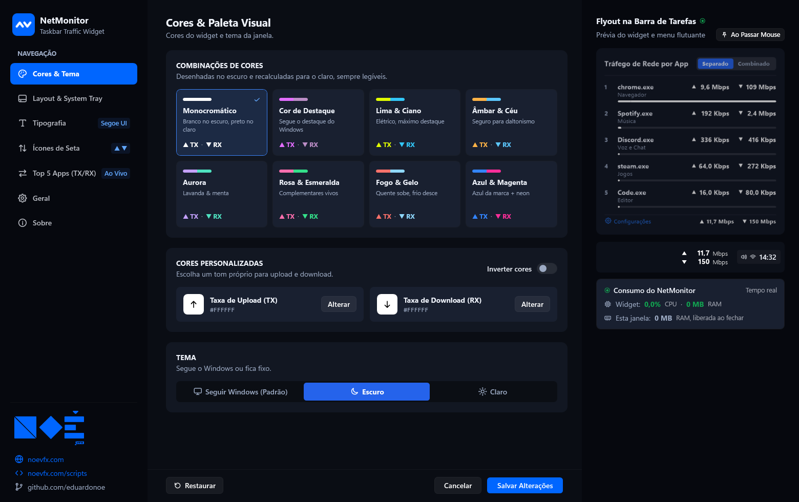
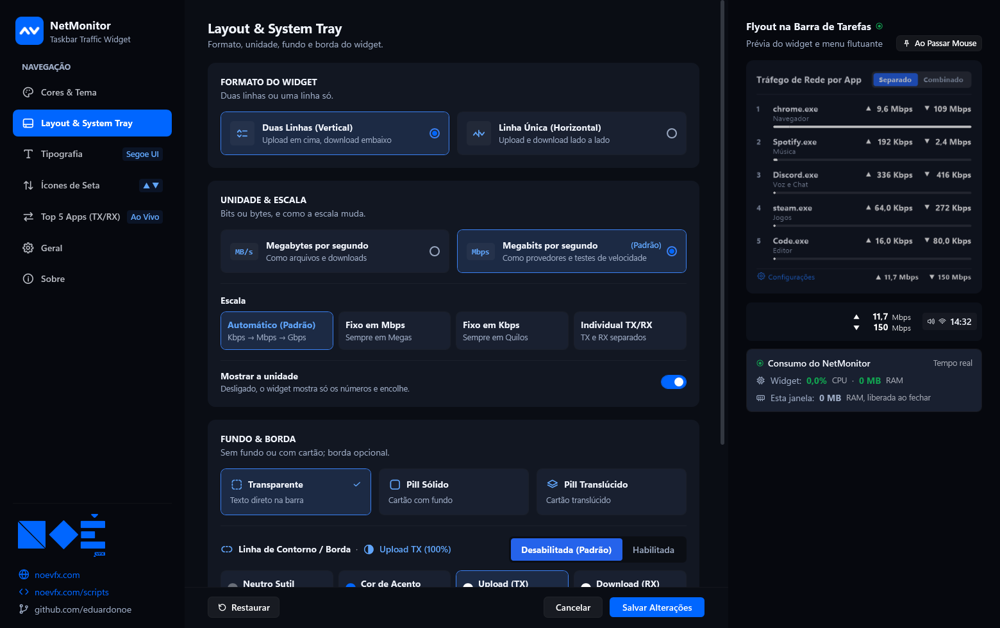
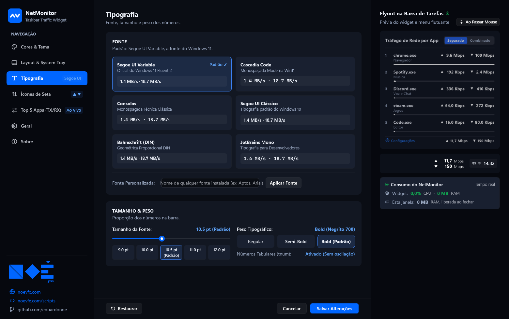
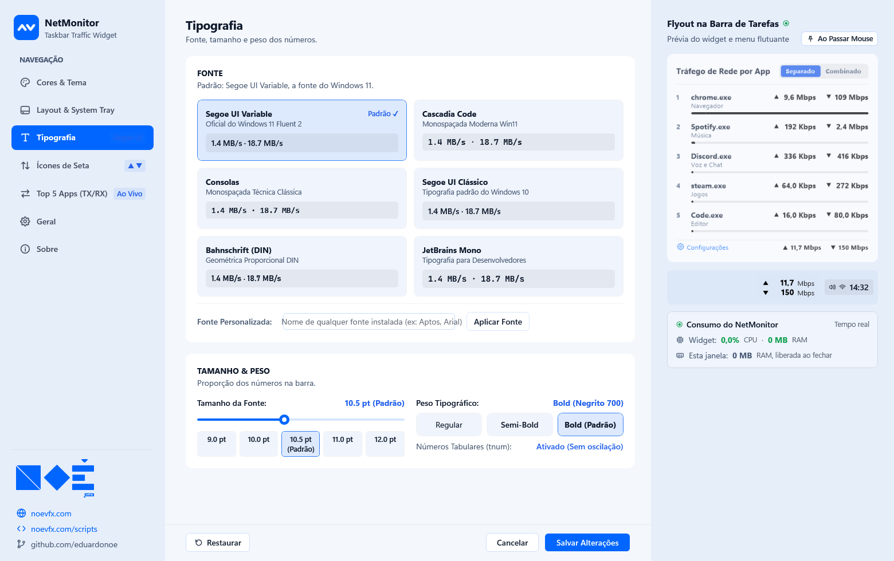
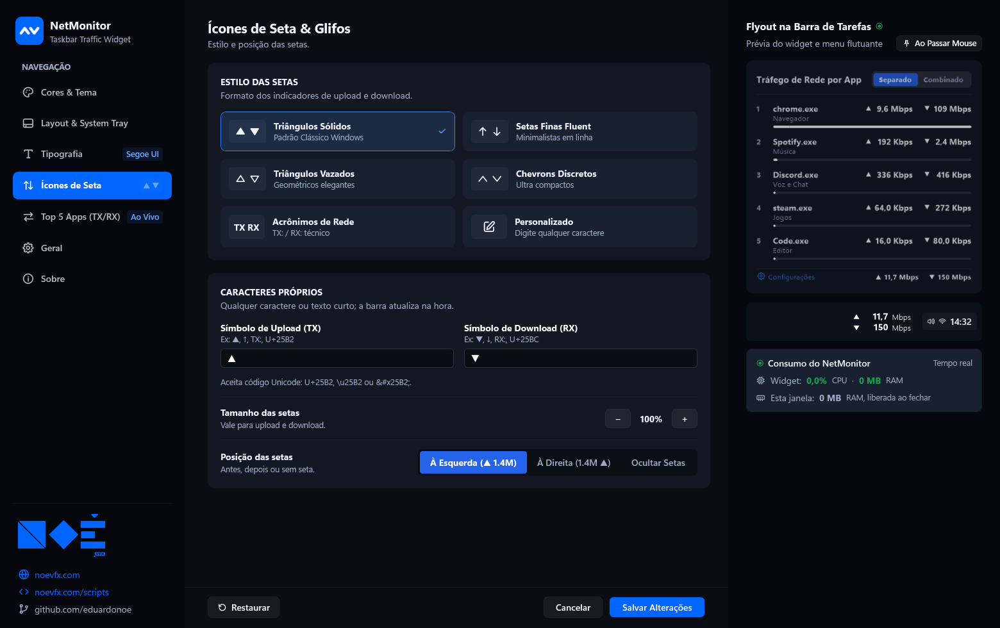
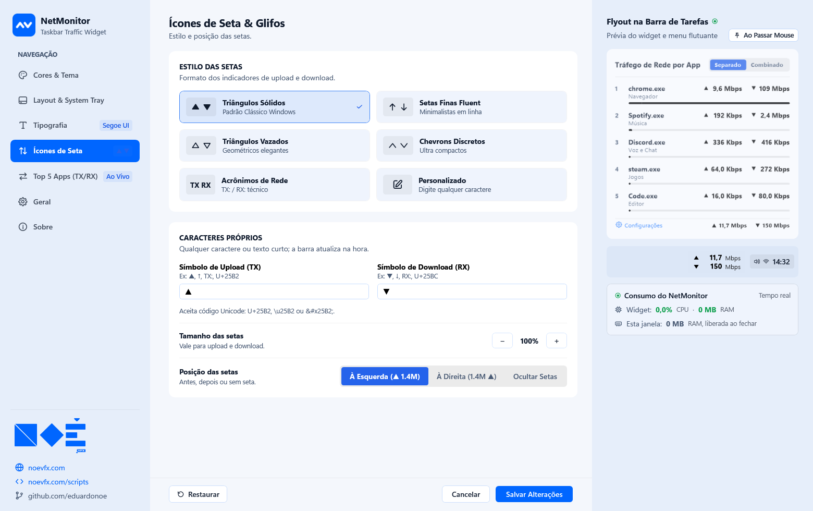
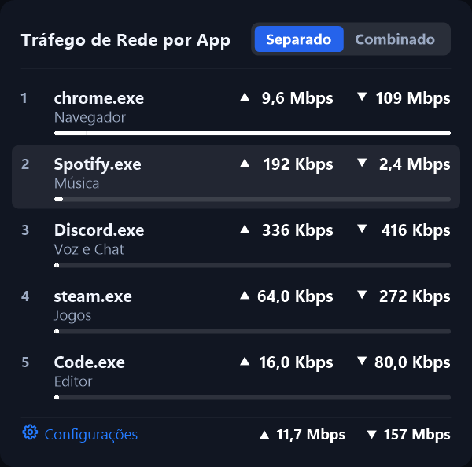
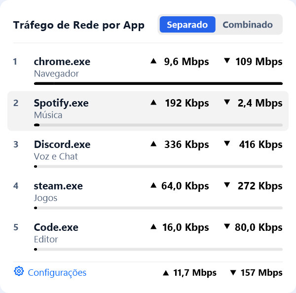

# NetMonitor

<div align="center">


### Upload e download em tempo real, direto na barra de tarefas do Windows 11

[](https://github.com/eduardonoe/NetMonitor)
[](https://github.com/eduardonoe/NetMonitor)
[](https://github.com/eduardonoe/NetMonitor/releases/tag/v1.0.0)
[](LICENSE)

[**Instalador (.exe)**](https://github.com/eduardonoe/NetMonitor/releases/download/v1.0.0/NetMonitorSetup.exe) &nbsp;|&nbsp; [**Portátil (.zip)**](https://github.com/eduardonoe/NetMonitor/releases/download/v1.0.0/NetMonitor-Portable-v1.0.0.zip) &nbsp;|&nbsp; [**Pacote completo (.zip)**](https://github.com/eduardonoe/NetMonitor/releases/download/v1.0.0/NetMonitor-v1.0.0.zip)

</div>

---

## Visão geral

O **NetMonitor** mostra as taxas de **upload (TX)** e **download (RX)** ao lado do relógio da barra de tarefas e, ao passar o mouse, abre um painel com os **5 apps que mais usam a rede**.

É um aplicativo **100% nativo**: C# + WPF + GDI+, compilado com o `csc.exe` que já vem no Windows. Sem navegador embutido, sem WebView2, sem dependências.

### Dois processos, pouca memória

| Processo | Função | RAM |
| :--- | :--- | :--- |
| `NetMonitor.exe` | Widget, flyout e menu (Windows Forms + GDI+, nunca carrega WPF) | **~12 a 18 MB** |
| `NetMonitor.exe --settings` | Janela de Configurações em WPF, aberta só quando você pede | ~135 MB, **liberados ao fechar** |

Os dois conversam por mensagens do Windows (`WM_COPYDATA`): a janela mostra a prévia ao vivo e o widget aplica as mudanças na hora.

---

## Recursos

### Widget na barra de tarefas
- Encaixa sozinho **à esquerda da área de notificação** e acompanha mudanças na barra. Pode ser arrastado para qualquer lugar; **Redefinir posição** volta ao encaixe automático.
- Formato **duas linhas** ou **uma linha**, ordem upload/download configurável.
- Fundo **transparente**, **acrílico** ou **sólido**, com borda opcional.
- Unidades em **bits** (Kbps / Mbps / Gbps) ou **bytes** (KB/s / MB/s / GB/s), escala **automática** ou **individual** por sentido; a unidade pode ser ocultada.
- Clique com o botão direito em qualquer ponto do widget abre o menu (não só em cima do texto).
- Some sozinho com o protetor de tela ou com o Windows bloqueado.

### Cores & tema
- **8 combinações de cores**, desenhadas no tema escuro e recalculadas para o claro com contraste mínimo garantido:

  | | | | |
  | :--- | :--- | :--- | :--- |
  | **Monocromático** (padrão) | **Cor de Destaque** (segue o Windows) | **Lima & Ciano** | **Âmbar & Céu** (seguro p/ daltonismo) |
  | **Aurora** | **Rosa & Esmeralda** | **Fogo & Gelo** | **Azul & Magenta** (azul da marca + neon) |

- **Cores personalizadas** para upload e download (clique no quadrado ou em *Alterar*).
- **Inverter cores**: troca a cor do upload com a do download, no widget e nas cores personalizadas.
- Tema **Seguir Windows** (padrão), **Escuro** ou **Claro**. Ao trocar o tema do Windows, widget, flyout e menu (mesmo aberto) mudam na hora.

### Tipografia
- Fonte padrão **Segoe UI Variable** (a do Windows 11), também Segoe UI Variable Display, Cascadia Code e Consolas.
- Tamanho (padrão **10,5 pt**) e peso ajustáveis.

### Setas
- 6 estilos: **Triângulos Sólidos**, **Setas Finas**, **Triângulos Vazados**, **Chevrons**, **TX:/RX:** e **Personalizado**.
- Caractere próprio aceita texto ou código (`U+2191`, `↑`, `0x2191`, `&#x2191;`).
- Setas à esquerda ou à direita dos números; tamanho ajustável com **− / +**.

### Flyout dos apps (Top 5)
- Os 5 apps com mais tráfego, numerados, com barra proporcional e colunas TX/RX alinhadas.
- Modo **Separado** (TX e RX) ou **Combinado**.
- Abre **ao passar o mouse** ou fica **fixado aberto**; pode ser **desativado**.
- Rodapé com atalho para **Configurações** e o total da máquina.
- Ignora tráfego de loopback (opcional).

### Menu de contexto
Organizado em seções: **Unidade**, **Escala**, **Flyout** (ativado, abrir ao passar o mouse, fixado aberto) e **Mais opções** (placa de rede, posição das setas, idioma, separado/combinado, travar posição, iniciar com o Windows, redefinir posição), além de Configurações, Sobre e Sair.

### Janela de Configurações
- 7 páginas: **Cores & Tema**, **Layout & System Tray**, **Tipografia**, **Ícones de Seta**, **Top 5 Apps**, **Geral**, **Sobre**.
- Prévia ao vivo do widget e do flyout na lateral, com o consumo de CPU/RAM do próprio NetMonitor.
- **Salvar**, **Cancelar** (desfaz tudo) e **Restaurar** (padrão de fábrica).

### Instalador
- Assistente nativo em WPF que segue o tema do Windows, em português e inglês, com atalhos, início com o Windows e desinstalador.

---

## Telas

| Escuro | Claro |
| :---: | :---: |
|  |  |
|  |  |
|  |  |
|  |  |
|  |  |

<div align="center">

</div>

---

## Instalação

1. **Instalador** (`NetMonitorSetup.exe`): instala em `%LocalAppData%\Programs\NetMonitor` (sem administrador), cria atalhos e o desinstalador.
2. **Portátil** (`NetMonitor-Portable-v1.0.0.zip`): descompacte e abra `NetMonitor.exe`. As preferências ficam em `HKCU\Software\NetMonitor`.

**Requisitos:** Windows 11 ou 10, .NET Framework 4.8 (já vem no Windows).

---

## Compilar

```powershell
# na pasta NetMonitor
.\build.ps1
```

Gera `bin/` e os pacotes em `release/v1.0.0/` (instalador, portátil e pacote completo, cada zip com este README).

---

## Autor

**Eduardo Noé** — [Noé VFX](https://noevfx.com) · [noevfx.com/scripts](https://noevfx.com/scripts) · [labs@noevfx.com](mailto:labs@noevfx.com)

Gostou? Apoie pelo **Pix** na aba *Sobre* do app — chave `a772dce2-7cf6-45db-a699-2102e189b30b` (Noé VFX).

## Licença

MIT — veja [LICENSE](LICENSE).
