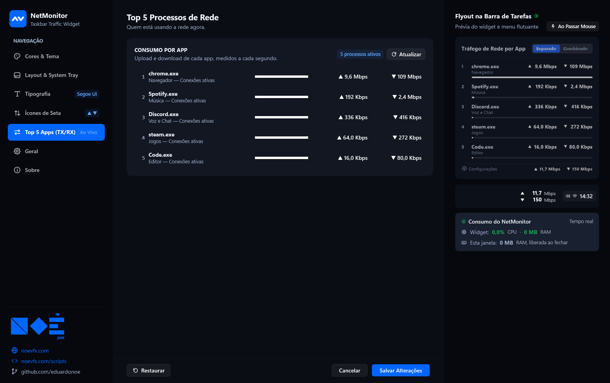

# NetMonitor

<div align="center">


### Monitor de Rede Inteligente e Minimalista para Windows 11
*Acompanhe seu tráfego de download e upload em tempo real, direto na barra de tarefas ou na tela, com elegância e performance nativa.*

[](https://github.com/eduardonoe/NetMonitor)
[](https://github.com/eduardonoe/NetMonitor)
[](https://github.com/eduardonoe/NetMonitor/releases/tag/v1.0.0)
[](LICENSE)

[**Download do Instalador (.exe)**](https://github.com/eduardonoe/NetMonitor/releases/download/v1.0.0/NetMonitorSetup.exe) &nbsp;|&nbsp; [**Download Versão Portátil (.zip)**](https://github.com/eduardonoe/NetMonitor/releases/download/v1.0.0/NetMonitor-Portable-v1.0.0.zip) &nbsp;|&nbsp; [**Pacote Completo (.zip)**](https://github.com/eduardonoe/NetMonitor/releases/download/v1.0.0/NetMonitor-v1.0.0.zip)

</div>

---

## ⚡ Visão Geral & Arquitetura de Processos

O **NetMonitor** é um aplicativo nativo projetado para o Windows 11 e 10 que monitora continuamente as taxas de **Upload (TX)** e **Download (RX)** da sua rede ativa, além de inspecionar em tempo real o tráfego individual dos aplicativos que mais consomem largura de banda.

Construído em **C# puro e WPF nativo**, sem Chromium e **sem WebView2 embutido**, o NetMonitor adota uma **arquitetura de dois processos isolados** para máxima estabilidade e eficiência de recursos:

1. **Processo Principal (`NetMonitor.exe`) — Widget & Monitoramento em Segundo Plano:**
   - Permanece ativo na barra de tarefas ou flutuando na tela.
   - Amostragem contínua via `GetExtendedTcpTable` e filtros de placa física.
   - **Consumo**: apenas **~0.1% de CPU** e **~55 a 65 MB de RAM**.
2. **Processo Secundário (`NetMonitor.exe --settings`) — Central de Configurações WPF:**
   - Inicia de forma isolada exclusivamente quando você abre as configurações.
   - Comunica-se com o processo principal via canal de IPC ultrarrápido (*Named Pipes*).
   - Renderiza a suíte completa de customização com aceleração por hardware e painel lateral de *Live Preview* em tempo real.
   - **Consumo**: **~135 a 150 MB de RAM** exclusivamente enquanto a janela estiver aberta.
   - **Desalocação Completa**: ao fechar a janela de configurações, esse processo é imediatamente encerrado e toda a memória é liberada para o sistema.
3. **Consumo Total Combinado**: cerca de **~190 a 200 MB de RAM** apenas no pico de uso com ambas as janelas abertas simultaneamente.

---

## ✨ Recursos Completos & Detalhados

### 🚀 1. Performance Nativa & Discrição
- **100% Nativo (.NET Framework 4.8)**: Executa com o runtime padrão do Windows. Sem dependências pesadas, sem Node.js e sem navegadores embutidos.
- **CPU Mínima (~0.1%)**: Loop de telemetria otimizado com timers cooperativos que não interferem em jogos ou renders pesados.
- **Boot 100% Silencioso**: Inicia junto com o Windows de forma imperceptível, sem emitir notificações ou toasts irritantes no carregamento.
- **Privacidade & Descanso de Tela**: O widget se oculta automaticamente quando o protetor de tela é acionado ou quando o Windows é bloqueado (`Win + L`).

### 🎨 2. Cores & Tema (Fluent 2)
- **Tema Dinâmico**: Alternância fluida entre **Modo Escuro**, **Modo Claro** ou sincronização automática com o tema do Windows.
- **4 Paletas Assinadas com Calibração Científica de Contraste**:
  1. ⚪ **Monocromático (`pure_mono`)**: Branco no tema escuro, preto no claro (máximo contraste e elegância).
  2. 💠 **Cor de Destaque (`accent`)**: Conecta-se em tempo real com a cor de destaque do seu Windows (lida dinamicamente do DWM).
  3. 🔶 **Âmbar & Céu (`ambar_ceu`)**: Par cromático baseado na escala Okabe-Ito, 100% acessível e seguro para pessoas com daltonismo.
  4. 🔮 **Aurora (`aurora`)**: Combinação estética e suave de lavanda e menta.
- **Cores Customizadas**: Seletor livre para definir qualquer cor hexadecimal personalizada para Upload e Download individualmente.

### 📐 3. Layout & Estilo do Widget
- **Modos de Exibição**:
  - **2 Linhas (Compacto)**: Empilhado, ideal para o espaço vertical da barra de tarefas.
  - **1 Linha (Horizontal)**: Disposição linear lado a lado.
- **Ordem das Métricas**: Escolha entre exibir Upload primeiro ou Download primeiro.
- **Fundo do Widget**: Opções de fundo **Transparente**, **Acrílico Translúcido** com desfoque suave ou **Sólido**.
- **Borda Configurável**: Liga/desliga borda com controle de opacidade via slider e seleção de cor (automática acompanhando a velocidade ou cor sólida customizada).
- **Unidades Flexíveis**:
  - **Bits Reais (Mbps / Gbps / Kbps)**: A métrica real contratada com seu provedor de internet.
  - **Bytes (MB/s / GB/s / KB/s)**: Ideal para acompanhar downloads de arquivos e torrents.
  - **Escala Automática ou Individual**: Alterna dinamicamente entre Kilo, Mega e Giga.
  - Opção para ocultar ou exibir o rótulo de unidade.

### 🔤 4. Tipografia & Fim do Tremor de Dígitos
- **Dígitos Tabulares (`tnum`)**: Largura numérica fixa para eliminar de vez o tremor (*jitter*) na tela conforme as taxas oscilam.
- **Famílias Nativas Suportadas**: Segoe UI Variable Display, Segoe UI, Cascadia Code, Consolas e Arial.
- **Controle Fino de Escala**: Slider de tamanho de fonte e seleção de peso (Regular, SemiBold, Bold).

### 🏹 5. Indicadores Vetoriais de Tráfego
- **6 Presets de Setas**:
  1. **Triângulos Sólidos**: Clássicos e limpos.
  2. **Linhas Finas**: Modernos e minimalistas.
  3. **Outline**: Vazados com traço elegante.
  4. **Chevrons**: Estilo angular Fluent 2.
  5. **Texto TX / RX**: Rótulos textuais informativos.
  6. **Customizado**: Permite informar qualquer caractere ou símbolo Unicode de sua preferência.
- **Posição das Setas**: À esquerda ou à direita dos números.
- **Escala Proporcional**: Ajuste de tamanho relativo das setas (de 60% a 140% do tamanho do texto).

### 📊 6. Flyout Inteligente do Top 5 Processos
- **Consumo em Tempo Real por App**: Ao passar o cursor (*hover*) ou clicar, um painel suave revela os 5 maiores consumidores de rede.
- **Upload (TX) e Download (RX) Separados**: Cada aplicativo exibe sua taxa de subida e descida individualmente com barras de progresso proporcionais.
- **Animação Bézier Suave**: Abertura e fechamento com curva `cubic-bezier(0, 0, 0, 1)` de 280ms.
- **Filtro de Loopback e I/O de Disco**: Monitoramento via tabelas TCP/UDP do Windows ignorando conexões locais (`127.0.0.1`) e operações de disco, garantindo leitura estritamente de dados que trafegam pela placa de rede física.
- **Modos de Acionamento**: Ao passar o mouse, por clique ou fixado permanentemente na tela.

### 🎛️ 7. Central de Configurações com Live Preview ao Vivo
- **Painel Lateral com Prévias em Tempo Real**: Veja exatamente como o widget e o flyout ficarão na sua barra de tarefas antes mesmo de salvar as alterações.
- **Botões de Ação**: Salvar configurações, Cancelar (reversão instantânea) e Restaurar Padrões de Fábrica.
- **Notificações Toast Internas**: Confirmações visuais elegantes dentro da própria janela.

---

## 📸 Galeria de Telas

### Central de Configurações (Dark & Light)

| Modo Escuro (Dark) | Modo Claro (Light) |
| :---: | :---: |
|  |  |
| *Personalização de Cores e 4 Paletas Assinadas* | *Interface Clara com Recálculo de Contraste* |
|  |  |
| *Ajuste de Dimensões, Borda, Fundo e Unidades* | *Configuração de Layout e Ordem de Métricas* |
|  |  |
| *Fontes do Sistema e Dígitos Tabulares Sem Tremor* | *Ajuste Tipográfico com Preview Lateral* |
|  |  |
| *6 Presets de Indicadores Vetoriais e Escala* | *Configuração de Setas em Modo Claro* |

### Monitor de Apps em Tempo Real & Flyout

| Flyout Suspenso (Hover) | Monitor de Processos |
| :---: | :---: |
|  |  |
| *Consumo ao vivo por aplicação com curvas suaves* | *Ajustes de amostragem e telemetria de rede* |

### Instalador Nativo WPF

<div align="center">

<br>
<em>Assistente de instalação moderno, bilíngue e integrado ao sistema.</em>
</div>

---

## 🎯 Atalhos & Modo de Uso

- **Arrastar e Posicionar**: O widget pode ser posicionado livremente em qualquer lugar da tela ou sobre a barra de tarefas.
- **Duplo Clique**: Abre imediatamente a Central de Configurações.
- **Clique Simples / Hover**: Abre o Flyout do Top 5 Processos.
- **Botão Direito (Menu de Contexto)**:
  - ⚙️ **Configurações...**
  - 📌 **Bloquear Posição** (trava o widget contra arrastos acidentais)
  - 🌐 **Unidade de Velocidade** (alterna entre Mbps e MB/s)
  - 🌓 **Tema** (Sistema / Escuro / Claro)
  - ❌ **Sair**

---

## 🛠️ Requisitos de Sistema

- **Sistema Operacional**: Windows 11 ou Windows 10 (64-bit recomendado).
- **Framework**: .NET Framework 4.8 (nativo e já pré-instalado no Windows).
- **Memória RAM**: ~55 MB (modo widget contínuo) / ~190 MB (durante uso da central de configurações).
- **GPU**: Compatível com qualquer acelerador gráfico padrão (GDI+/WPF com aceleração por hardware).

---

## 📦 Como Instalar

1. **Instalador Oficial (`NetMonitorSetup.exe`)**:
   - Baixe e execute. Ele cria atalhos no Menu Iniciar, permite inicialização automática e inclui desinstalador limpo.
2. **Versão Portátil (`NetMonitor Portable`)**:
   - Baixe o `.zip`, descompacte em qualquer pasta ou pendrive e execute `NetMonitor.exe`. Não altera o Registro nem exige direitos de administrador.

---

## 🔨 Compilando a partir do Código-Fonte

O projeto utiliza o compilador nativo `csc.exe` do .NET Framework 4 incluído no próprio Windows:

```powershell
# No PowerShell, na pasta raiz do NetMonitor:
.\build.ps1
```

O script compila os binários em `bin/` e empacota automaticamente os instaladores e arquivos compactados em `release/`.

---

## 🤝 Autor e Suporte

Desenvolvido por **Eduardo Noé** ([Noé VFX](https://noevfx.com)).

- 🌐 **Site Oficial**: [noevfx.com](https://noevfx.com)
- 💻 **Repositório Público de Releases**: [github.com/eduardonoe/NetMonitor](https://github.com/eduardonoe/NetMonitor)
- ✉️ **Contato & Suporte**: [labs@noevfx.com](mailto:labs@noevfx.com)
- ☕ **Apoie o Projeto**: Se o NetMonitor é útil no seu fluxo de trabalho, você pode apoiar via **Pix** na aba *Sobre* do aplicativo:
  - Chave Pix: `a772dce2-7cf6-45db-a699-2102e189b30b` (Noé VFX - Nubank PJ)

---

## 📄 Licença

Distribuído sob a licença **MIT**. Veja o arquivo `LICENSE` para mais informações.
